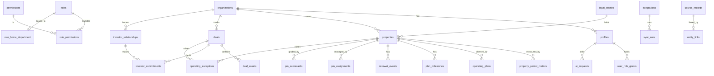

# Data model

Source of truth: `supabase/migrations/0001_schema.sql` and `0002_rls.sql`.

## Table groups and who can read them

| Group | Tables | Read rule (RLS) |
|---|---|---|
| Reference | roles, permissions, role_permissions | Any active user |
| Identity | profiles, user_role_grants, organizations | Self, or `manage_users` |
| Operations summary | properties, legal_entities | `view_company_summary` or `view_property_financials` in scope |
| Operations financial | property_period_metrics, operating_plans, plan_milestones, renewal_events, pm_assignments, pm_scorecards | `view_property_financials` in scope |
| Acquisitions | deals, deal_assets, `deals_safe` view | Summary in scope. Money fields only with `view_deal_financials` |
| Investor relations | investor_relationships, investor_commitments | `view_investor_pii` in scope |
| Exceptions | operating_exceptions | Visible when the underlying record is visible |
| Platform | integrations, sync_runs, source_records, entity_links, resource_scopes | `manage_integrations` (deal-linked source records follow deal scope) |
| Governance | ai_requests, audit_events | Own AI rows or `manage_ai`. Audit needs `manage_users` |

## Not modeled (on purpose)
No task table (Asana is canonical, tasks are cached read-only). No tenant ledger, KYC, bank, or tax identifiers.

## Writes
Ordinary users cannot insert, update, or delete anything except grants and deactivation (managers only, never on themselves, only an owner can create `owner_admin`). Ingestion and audit writes use the server-only service key.
